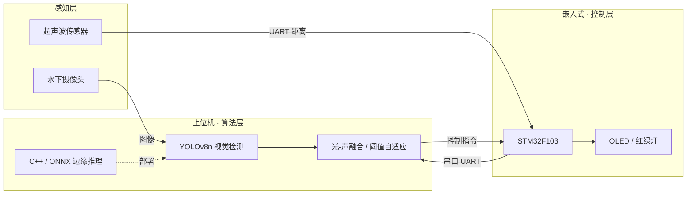

# 深瞳 · 基于光-声融合的水下垃圾智能感知系统

> 一个完整的软硬闭环边缘 AI 项目：**STM32 底层 → 上位机 → YOLOv8n 视觉检测 → ONNX 导出 → C++ 边缘部署**。

本项目源自「中国（国际）传感器创新创业大赛」，针对**水下光学衰减、镜头失焦、目标模糊**等真实工程问题，构建了一套「视觉 + 超声波」融合的水下垃圾检测系统，并将训练好的模型**从 Python 一路部署到 C++**。

---

## ✨ 项目亮点

- **软硬一体**：STM32F103 底层控制 + 上位机 + 视觉算法全链路打通
- **光-声融合**：利用超声波距离先验动态调整视觉置信度阈值，缓解水下误检
- **边缘部署**：YOLOv8n → ONNX → **C++（OpenCV `cv::dnn`）独立实现推理**
- **自建数据集**：自主采集并精细标注 500+ 张真实水下垃圾图像（4 类）

---

## 🏗 系统架构



---

## 📁 目录结构

```
Ocean_Eye/
├── dataset/            # 原始数据（图片 + 标签）
├── dataset_new/        # 补充数据
├── dataset_yolo/       # 划分后的 train/val（YOLO 格式）
├── YOLO/               # 标注文件
├── models/             # 训练好的权重（best.pt / best.onnx）
├── 训练.py             # 数据划分脚本
├── data.yaml           # 数据集配置
├── test_onnx.py        # Python 推理 + 测速
├── main.py             # 上位机串口通信
├── yoloploy/           # C++ 部署工程（VS 项目）
│   └── YoloDeploy/main.cpp   # C++ ONNX 推理
├── Ocean_Eye/          # STM32F103 底层（Keil 工程）
└── requirements.txt    # Python 依赖
```

---

## 🚀 快速开始

### 1. 环境准备（Python）

```bash
pip install -r requirements.txt
```

### 2. 训练（可选，权重已提供）

```bash
# 1) 先划分数据集
python 训练.py
# 2) 用 ultralytics 训练
yolo train model=yolov8n.pt data=data.yaml epochs=100 imgsz=640
```

### 3. Python 推理验证

```bash
python test_onnx.py
```

### 4. C++ 边缘部署

- 用 Visual Studio 打开 `yoloploy/YoloDeploy/YoloDeploy.vcxproj`
- 需自行安装 OpenCV（C++ 版），并将 `opencv_world*.dll` 放到可执行文件目录
- `main.cpp` 中的 `ONNX_PATH` / `IMG_PATH` 请改成你本地的路径

---

## 📊 数据集

| 项 | 说明 |
|---|---|
| 类别 | `bottle` / `soda_can` / `plastic` / `shell`（4 类）|
| 规模 | 500+ 张自主采集、精细标注的真实水下图像 |
| 难点 | 光学衰减、镜头失焦、目标模糊、类别长尾 |

---

## 🛠 技术栈

`STM32` · `YOLOv8n` · `ONNX` · `OpenCV` · `C++` · `Python` · `ROS2`（规划中）

---

## 📄 License

[MIT](./LICENSE)
